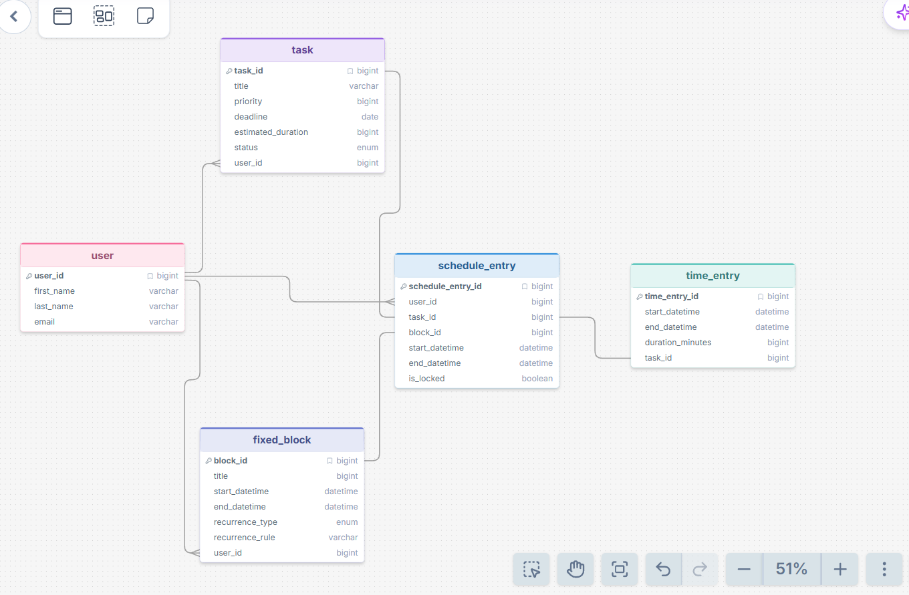

## Database Purpose

This database supports an automated schedule manager. It stores users’ tasks, deadlines, priorities, fixed commitments, and time entries so the app can generate an optimized schedule.


## Testing Approach

I tried asking direct questions about the database, such as “Which tasks have not started?” I also tried more specific questions about task deadlines. Finally, I tested unrelated questions that the database could not answer. The relevant questions generated SQL and returned database results, while unrelated questions returned `CANNOT_ANSWER`. I added this response so the system clearly says when it cannot answer, instead of treating the question as if it returned zero results.


## Database Schema




## Example of an Unsuccessful Query
**Question:** Why is the sky blue?

**Generated SQL:**
```text
CANNOT_ANSWER
```

**Response:** I can't answer that using the current database.

## Additional Examples

See [examples.md](example.md) for eight additional question-and-result examples.

## Prompting Strategies

I tested zero-shot prompting by asking questions directly without providing examples. I also tested few-shot prompting by including example question-and-SQL pairs to guide the model. I compared the generated SQL queries to see whether the examples improved accuracy. I also tested unrelated questions to evaluate whether the model could recognize questions that the database could not answer.
